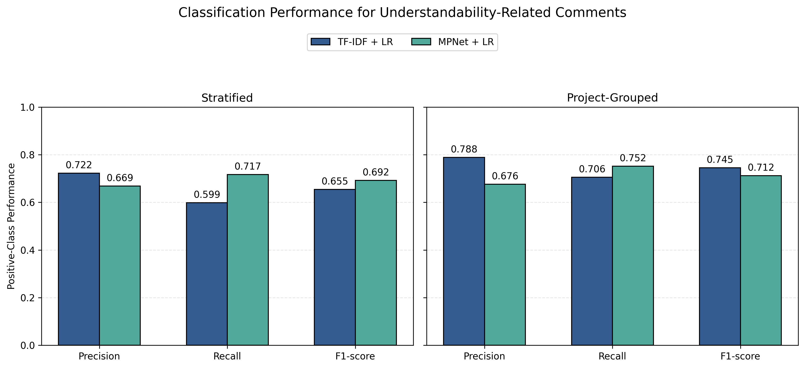
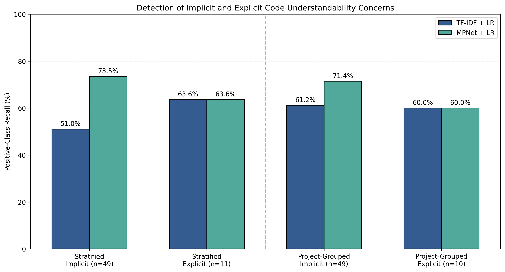
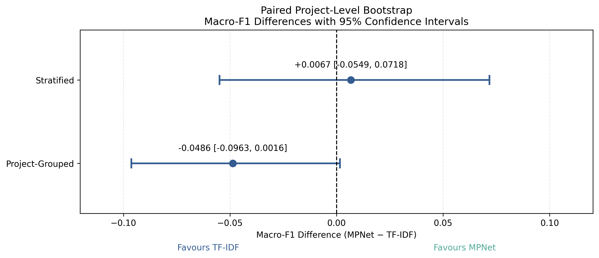
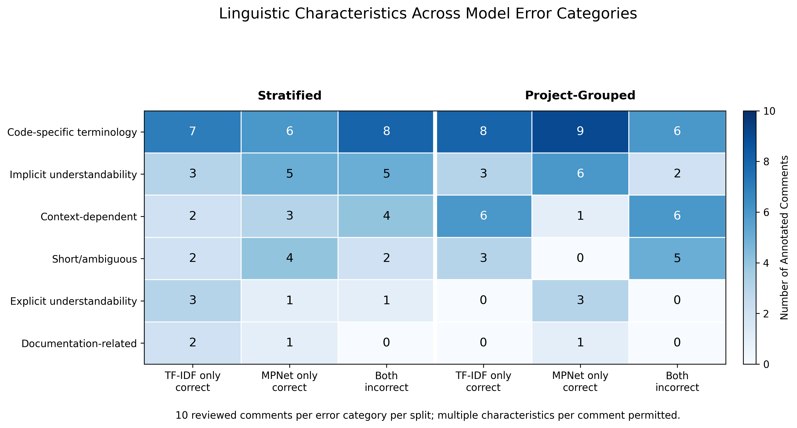
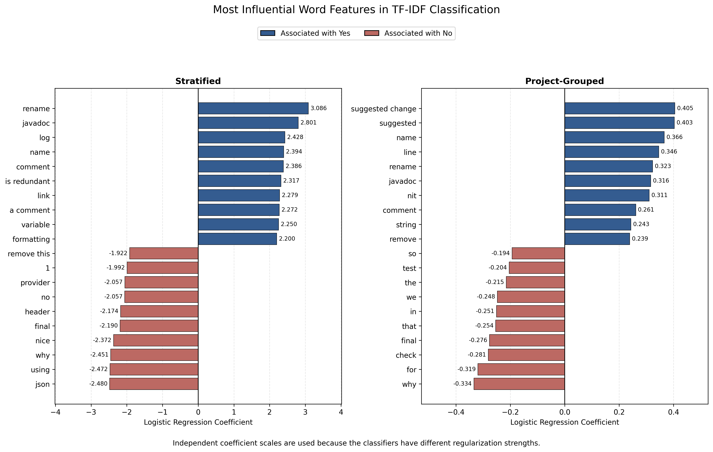
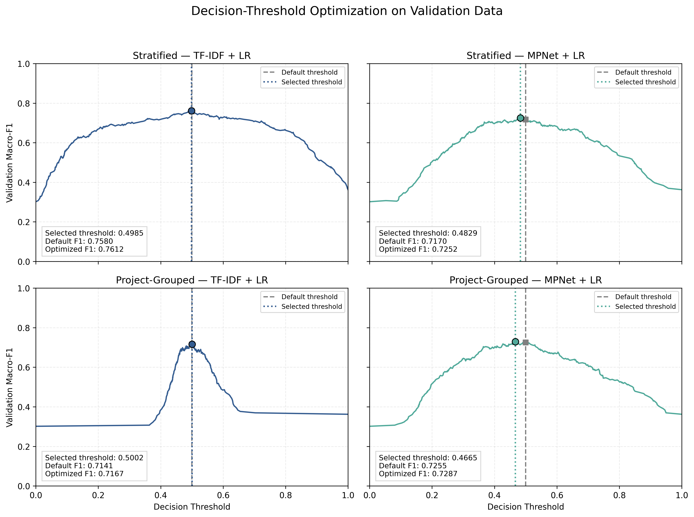
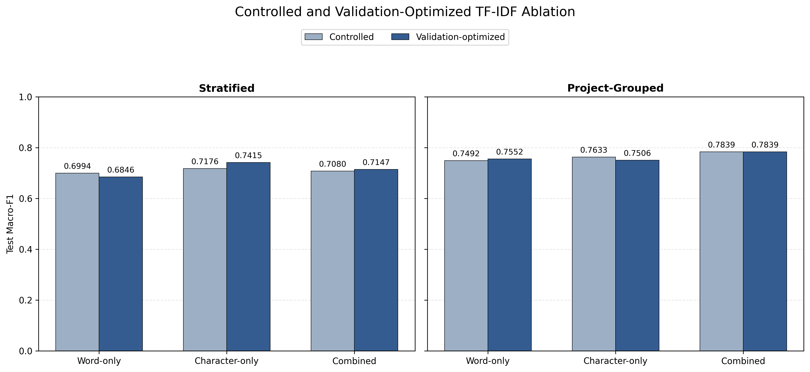
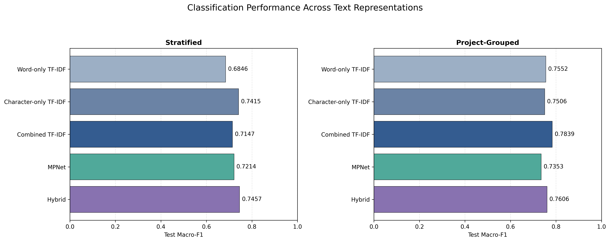

# Lexical vs. Semantic Approaches for Detecting Code-Understandability Comments in Software Reviews

A comparative NLP and machine learning project investigating whether code-review comments that concern **code understandability** can be identified automatically. The study compares lexical **word- and character-level TF-IDF** features against pretrained **Sentence-Transformer (`all-mpnet-base-v2`) embeddings**, using **Logistic Regression** for binary classification in both pipelines.

Supplementary experiments examine word-only and character-only TF-IDF ablation and a hybrid lexical-semantic classifier. The original comparison remains the primary analysis.

The project investigates the integration of natural language processing and machine learning into software engineering workflows, particularly automated code-review analysis and the identification of comments concerning code readability, comprehension, and maintainability.

Developed for **CSI 5187 — Applications of NLP and ML**, University of Ottawa.

## Research Questions

1. **RQ1:** Can NLP and machine learning models automatically identify code-review comments related to code-understandability improvements?
2. **RQ2:** Do semantic representations provide better classification performance than traditional lexical representations for this task?

## Dataset

The project uses the publicly available **CODE-UP (Code Understandability Improvement)** dataset, which contains manually annotated real-world code-review comments from 363 software projects.

- **Original dataset:** 2,401 comments (1,012 `Yes`, 1,333 `No`, and 56 `Discard`).
- **Binary classification dataset:** 2,345 comments after excluding `Discard` entries.
- **Input:** `bodyText` (text of the code-review comment).
- **Target:** `label` (`0` = No, `1` = Yes).
- **Metadata retained:** `id` and `project` for traceability, project-grouped evaluation, and subsequent error analysis. These are not used as classification features.

Original dataset: [CODE-UP repository](https://github.com/codeupcrc/codeupcrc.github.io) | [Source TSV](https://github.com/codeupcrc/codeupcrc.github.io/blob/main/csv/dataset.tsv)

### Dataset Characteristics

| Characteristic | Value |
|---|---:|
| Original review comments | 2,401 |
| Binary classification records | 2,345 |
| Software projects | 363 |
| Understandability-related comments (Yes) | 1,012 |
| Non-understandability-related comments (No) | 1,333 |
| Positive-class proportion | 43.16% |
| Negative-class proportion | 56.84% |
| Binary records belonging to repeated-text groups | 28 |
| Unique repeated comment texts | 11 |
| Repeated texts with conflicting binary labels | 0 |

Repeated comment texts are retained as distinct review records because identical comments may occur independently across software projects and review discussions. Their potential influence on classification performance is examined through a supplementary duplicate-text sensitivity analysis.

### Dataset Partitions

Two train/validation/test splitting strategies are used, targeting approximately **70% / 15% / 15%** proportions:

- **Stratified split:** Preserves the binary label distribution across partitions.
- **Project-grouped split:** Ensures that software projects are disjoint between training, validation, and testing to assess performance on previously unseen projects.

| Partition | Stratified | Project-grouped |
|---|---:|---:|
| Train | 1,641 | 1,639 |
| Validation | 352 | 352 |
| Test | 352 | 354 |
| Total | 2,345 | 2,345 |

The stratified splitting procedure uses a random seed of 42. The project-grouped splitting procedure evaluates candidate group-disjoint partitions to approximate the desired partition sizes and class distributions, using fixed random seeds for reproducibility.

## Methods

### Lexical Pipeline

- Word-level and character-level TF-IDF features combined using scikit-learn's `FeatureUnion`.
- Word n-grams and character n-grams capture lexical patterns, code-specific terminology, partial word matches, and recurring expressions.
- TF-IDF vectorizers are fitted exclusively on the training partition.
- Logistic Regression is used for binary classification.
- Hyperparameters are selected using validation macro-F1.
- Both unweighted (`class_weight=None`) and balanced (`class_weight="balanced"`) configurations are evaluated.
- An optimized decision threshold is selected using validation macro-F1.

### Semantic Pipeline

- Frozen pretrained `sentence-transformers/all-mpnet-base-v2` encoder.
- Generates 768-dimensional sentence embeddings using the pretrained model's pooling architecture.
- Maximum sequence length of 384 tokens.
- Logistic Regression is used for binary classification.
- Regularization strength, optional `StandardScaler`, and class weighting are evaluated using validation macro-F1.
- Both unweighted and balanced class-weight configurations are considered.
- The final selected semantic classifiers do not use additional feature standardization.
- An optimized decision threshold is selected using validation macro-F1.
- CUDA acceleration is used for embedding generation when available, with CPU execution supported by the implementation.

### Hyperparameter Search

| Hyperparameter | TF-IDF | MPNet |
|---|---|---|
| Word n-grams | (1, 2), (1, 3) | Not applicable |
| Character n-grams | (2, 5), (3, 5) | Not applicable |
| Minimum document frequency | 2 | Not applicable |
| Sublinear term frequency | True | Not applicable |
| Maximum character features | 30,000 | Not applicable |
| Regularization C | 0.1, 1, 10, 100 | 0.01, 0.1, 1, 10, 100 |
| Class weight | None, balanced | None, balanced |
| StandardScaler | Not applicable | True, False |
| Maximum LR iterations | 2,000 | 2,000 |
| Random seed | 42 | 42 |

Three predefined word/character n-gram combinations are evaluated for the lexical pipeline:

- Word (1, 2) and character (2, 5).
- Word (1, 3) and character (2, 5).
- Word (1, 2) and character (3, 5).

A total of 24 lexical configurations and 20 semantic configurations are evaluated per splitting strategy.

Hyperparameter selection is performed using validation macro-F1 at the default classification threshold. Subsequently, decision-threshold optimization is performed on the selected classifier using validation predictions.

### Selected Model Configurations

| Split | Model | C | Class weight | StandardScaler | Decision threshold |
|---|---|---:|---|---|---:|
| Stratified | TF-IDF | 10.0 | None | N/A | 0.498472 |
| Stratified | MPNet | 1.0 | Balanced | False | 0.482937 |
| Project-grouped | TF-IDF | 0.1 | Balanced | N/A | 0.500206 |
| Project-grouped | MPNet | 1.0 | Balanced | False | 0.466549 |

Both selected TF-IDF classifiers use word n-grams of (1, 2) and character n-grams of (3, 5).

### Evaluation Methodology

Both pipelines use identical dataset partitions within each splitting strategy, the same classifier family, and consistent evaluation metrics. Hyperparameters and decision thresholds are independently optimized using validation data.

**Macro-F1** is the primary model-selection and comparison metric. Additional evaluation metrics include:

- Accuracy.
- Macro-precision.
- Macro-recall.
- Class-specific precision, recall, and F1-score.
- Confusion matrices.
- Majority-class baseline performance.

The independently optimized classifier configurations mean that observed performance differences cannot be attributed exclusively to the underlying text representation.

## Primary Experimental Results

The results below correspond to the two primary pipelines after expanded class-weight evaluation and validation-based decision-threshold optimization. The ablation and hybrid models are reported separately.

### Test Performance

| Split | Model | Accuracy | Macro-precision | Macro-recall | Macro-F1 |
|---|---|---:|---:|---:|---:|
| Stratified | TF-IDF + LR | **0.7273** | **0.7262** | 0.7118 | 0.7147 |
| Stratified | MPNet + LR | 0.7244 | 0.7206 | **0.7236** | **0.7214** |
| Project-grouped | TF-IDF + LR | **0.7910** | **0.7905** | **0.7808** | **0.7839** |
| Project-grouped | MPNet + LR | 0.7373 | 0.7350 | 0.7390 | 0.7353 |

### Majority-Class Baseline Comparison

| Split | Majority baseline macro-F1 | TF-IDF macro-F1 | MPNet macro-F1 |
|---|---:|---:|---:|
| Stratified | 0.3623 | 0.7147 | 0.7214 |
| Project-grouped | 0.3622 | 0.7839 | 0.7353 |

Both classification approaches substantially outperform the majority-class baseline, supporting the feasibility of automatically identifying code-understandability-related review comments.

### Positive-Class Performance

The positive class represents comments related to code-understandability improvements (`Yes`).

| Split | Model | Precision | Recall | F1-score |
|---|---|---:|---:|---:|
| Stratified | TF-IDF | **0.7222** | 0.5987 | 0.6547 |
| Stratified | MPNet | 0.6687 | **0.7171** | **0.6921** |
| Project-grouped | TF-IDF | **0.7883** | 0.7059 | **0.7448** |
| Project-grouped | MPNet | 0.6765 | **0.7516** | 0.7121 |



TF-IDF achieves higher positive-class precision under both splitting strategies, whereas MPNet achieves higher positive-class recall at the selected operating thresholds.

These findings illustrate a practical precision-recall trade-off for automated software review assistance systems.

## Supplementary Experimental Analyses

### Implicit vs. Explicit Understandability

The original CODE-UP dataset contains additional annotations distinguishing implicitly and explicitly expressed understandability concerns.

Among the 1,012 positive comments:

| Annotation category | Comments |
|---|---:|
| Implicit | 335 |
| Explicit | 50 |
| Unannotated | 627 |
| Total | 1,012 |

The supplementary evaluation measures positive-class recall within these subgroups using the existing test predictions.

| Split | Category | Support | TF-IDF recall | MPNet recall |
|---|---|---:|---:|---:|
| Stratified | Implicit | 49 | 0.5102 | **0.7347** |
| Stratified | Explicit | 11 | 0.6364 | 0.6364 |
| Project-grouped | Implicit | 49 | 0.6122 | **0.7143** |
| Project-grouped | Explicit | 10 | 0.6000 | 0.6000 |



MPNet achieves higher recall on implicitly expressed understandability concerns under both splitting strategies. The models achieve identical recall on explicitly annotated comments within each split.

These findings remain exploratory because only a subset of positive comments has implicit/explicit annotations, explicit subgroup sizes are small, and MPNet exhibits higher positive-class recall more generally.

### Duplicate-Text Sensitivity Analysis

A supplementary robustness analysis evaluates the influence of exact comment-text overlap across training, validation, and test partitions.

Test records whose text appears in either training or validation are excluded from the supplementary evaluation. The original trained classifiers and decision thresholds remain unchanged.

| Split | Original test size | Excluded records | Filtered test size |
|---|---:|---:|---:|
| Stratified | 352 | 5 | 347 |
| Project-grouped | 354 | 4 | 350 |

| Split | Model | Original macro-F1 | Filtered macro-F1 |
|---|---|---:|---:|
| Stratified | TF-IDF | 0.7147 | 0.7098 |
| Stratified | MPNet | 0.7214 | 0.7198 |
| Project-grouped | TF-IDF | 0.7839 | 0.7808 |
| Project-grouped | MPNet | 0.7353 | 0.7319 |

The maximum observed reduction in macro-F1 is less than 0.5 percentage points. The relative ranking of the classifiers remains unchanged under both splitting strategies.

This analysis evaluates sensitivity to exact text overlap but does not establish the absence of near-duplicate, semantic, or other forms of data leakage.

### Statistical Significance and Confidence Intervals

Two complementary statistical procedures are implemented:

- **Exact McNemar's test:** Compares paired classification correctness using the two-sided exact binomial test.
- **Paired project-level bootstrap:** Estimates uncertainty in macro-F1 and differences between classifiers by resampling software projects with replacement.

McNemar's tests are adjusted using the Holm multiple-comparison correction at a significance level of 0.05.

The bootstrap procedure uses 10,000 iterations per splitting strategy, a random seed of 42, and 95% percentile confidence intervals.

The difference in macro-F1 is defined as:

`Macro-F1 difference = MPNet macro-F1 - TF-IDF macro-F1`

| Split | Exact McNemar p-value | Holm-adjusted p-value | Macro-F1 difference | Paired 95% bootstrap CI |
|---|---:|---:|---:|---|
| Stratified | 1.000000 | 1.000000 | +0.006691 | [-0.054869, 0.071770] |
| Project-grouped | 0.047525 | 0.095050 | -0.048639 | [-0.096263, 0.001579] |



Neither McNemar comparison remains statistically significant after Holm correction. Furthermore, neither paired bootstrap confidence interval excludes zero.

Consequently, neither classifier demonstrates statistically established superiority. This does not establish that the classifiers are equivalent.

The bootstrap confidence intervals quantify test-sample uncertainty conditional on the existing trained models and partitions. They do not estimate variability arising from model retraining or alternative dataset partitions.

## Error Analysis

The project exports false-positive and false-negative summaries, paired model disagreements, cases where only one model is correct, and cases where both models fail.

### Model Agreement and Disagreement

| Category | Stratified | Project-grouped |
|---|---:|---:|
| Both correct | 198 | 229 |
| TF-IDF only correct | 58 | 51 |
| MPNet only correct | 57 | 32 |
| Both incorrect | 39 | 42 |
| Total disagreements | 115 | 83 |
| Total test comments | 352 | 354 |

The disagreement analysis demonstrates that the two representations exhibit complementary classification behaviour, while also sharing limitations on certain review comments.

### Qualitative Linguistic Analysis

A manually reviewed qualitative sample of **60 records** contains 10 examples from each of three error categories for each splitting strategy:

- TF-IDF only correct.
- MPNet only correct.
- Both models incorrect.

The annotations consider six linguistic characteristics:

| Linguistic characteristic | Frequency |
|---|---:|
| Code-specific terminology | 44 |
| Implicit understandability | 24 |
| Context-dependent | 22 |
| Short/ambiguous | 16 |
| Explicit understandability | 8 |
| Documentation-related | 4 |



Implicit understandability occurs more frequently in the MPNet-only-correct sample than in the TF-IDF-only-correct sample under both splitting strategies.

Context-dependent and short or ambiguous comments also appear among cases where both classifiers fail, illustrating the challenges of classifying code-review comments without surrounding software development context.

The linguistic characteristics are **non-exclusive**, allowing multiple annotations per comment. Their frequencies describe the deliberately balanced error-analysis sample rather than the entire dataset.

## TF-IDF Feature Interpretability

The fitted Logistic Regression coefficients are examined to identify word and character n-grams associated with positive and negative predictions.

| Feature inventory | Stratified | Project-grouped |
|---|---:|---:|
| Word features | 4,622 | 4,583 |
| Character features | 30,000 | 30,000 |
| Total features | 34,622 | 34,583 |

The analysis extracts the top 15 positive and negative coefficients for each feature type and splitting strategy, producing 120 ranked feature records.

Several positively associated word features recur across both classifiers:

- `rename`
- `javadoc`
- `name`
- `comment`
- `variable`
- `unused`
- `line`
- `log`
- `link`

These lexical associations relate to software engineering activities involving identifier naming, documentation, formatting, code cleanliness, and review suggestions.



The coefficient analysis describes learned statistical associations rather than causal explanations. Coefficient magnitudes should not be directly compared across classifiers with different regularization strengths.

## Decision-Threshold Optimization

Decision thresholds are selected exclusively using validation predictions after hyperparameter selection.

| Split | Model | Default validation macro-F1 | Selected threshold | Optimized validation macro-F1 |
|---|---|---:|---:|---:|
| Stratified | TF-IDF | 0.7580 | 0.498472 | 0.7612 |
| Stratified | MPNet | 0.7170 | 0.482937 | 0.7252 |
| Project-grouped | TF-IDF | 0.7141 | 0.500206 | 0.7167 |
| Project-grouped | MPNet | 0.7255 | 0.466549 | 0.7287 |



All four classifiers achieve modest improvements in validation macro-F1 through threshold optimization.

The selected thresholds are subsequently applied to the corresponding test partitions without further threshold adjustment.

## Supplementary Representation Experiments

Two additional exploratory experiments investigate the contribution of individual lexical feature groups and the potential benefit of combining lexical and semantic representations. Both reuse the existing dataset partitions and preserve the primary classifiers, test predictions, and reviewed qualitative annotations.

### TF-IDF Ablation Study

Three representations are compared: word-only TF-IDF, character-only TF-IDF, and the existing combined word- and character-level TF-IDF classifier. Two evaluation approaches are employed:

- **Controlled ablation:** Retrain reduced representations using the original combined classifier's regularization strength and class weight, and compare all three at a common decision threshold of 0.5.
- **Validation-optimized ablation:** Select regularization and class weight independently for each reduced representation using validation macro-F1 at the default threshold, then optimize its threshold using validation predictions. The existing combined classifier retains its original selected configuration and threshold.

The reduced representations clone the corresponding original vectorizer configurations and fit them on training comments only. Word n-grams (1, 2) and character n-grams (3, 5) are retained. The search evaluates `C` in {0.1, 1, 10, 100} and class weight in {None, balanced}, with a random seed of 42 and a maximum of 2,000 iterations. There are 32 additional classifier fits across both splitting strategies; the controlled reduced models are drawn from the same search, and the original combined models are loaded without retraining.

| Split | Reduced representation | Selected C | Class weight | Threshold | Optimized validation macro-F1 |
|---|---|---:|---|---:|---:|
| Stratified | Word-only | 0.1 | Balanced | 0.497811 | 0.728504 |
| Stratified | Character-only | 10.0 | None | 0.454601 | 0.754223 |
| Project-grouped | Word-only | 1.0 | Balanced | 0.500000 | 0.711446 |
| Project-grouped | Character-only | 10.0 | Balanced | 0.467215 | 0.730130 |

| Representation | Stratified controlled F1 | Stratified optimized F1 | Project-grouped controlled F1 | Project-grouped optimized F1 |
|---|---:|---:|---:|---:|
| Word-only | 0.6994 | 0.6846 | 0.7492 | 0.7552 |
| Character-only | **0.7176** | **0.7415** | 0.7633 | 0.7506 |
| Combined | 0.7080 | 0.7147 | **0.7839** | **0.7839** |



Character-only TF-IDF achieves the highest observed test macro-F1 among lexical representations in the stratified split, whereas combined TF-IDF performs best in the project-grouped split. This ranking is consistent under both ablation protocols. Validation optimization does not necessarily improve test performance, as illustrated by the stratified word-only and project-grouped character-only results.

The ablation is conditional on the selected n-gram configurations and tested hyperparameter ranges; it is not an exhaustive search for the best possible word-only or character-only representation.

### Hybrid Lexical-Semantic Classification

The hybrid classifier combines the existing fitted word- and character-level TF-IDF feature extractor with frozen, 768-dimensional MPNet embeddings through feature-level fusion. Each feature block is independently L2-normalized, and the semantic block is multiplied by a weight alpha before sparse concatenation. Zero vectors remain unchanged during normalization.

The concatenated representation is passed to Logistic Regression. Alpha controls the relative scale of the semantic block, not a percentage of semantic information or its causal contribution to predictions.

| Hyperparameter | Values |
|---|---|
| Semantic weight (alpha) | 0.5, 1.0, 2.0 |
| Regularization C | 0.01, 0.1, 1, 10, 100 |
| Class weight | None, balanced |
| Maximum LR iterations | 2,000 |
| Random seed | 42 |

The search evaluates 30 configurations per splitting strategy (60 in total). Hyperparameters are selected using validation macro-F1 at the default threshold, followed by validation-based threshold optimization.

| Parameter | Stratified | Project-grouped |
|---|---:|---:|
| Semantic weight | 0.5 | 1.0 |
| Regularization C | 10.0 | 10.0 |
| Class weight | None | Balanced |
| Hybrid feature dimension | 35,390 | 35,351 |
| Selected threshold | 0.520180 | 0.466237 |
| Default validation macro-F1 | 0.769819 | 0.734516 |
| Optimized validation macro-F1 | 0.777356 | 0.738614 |
| Test accuracy | 0.758523 | 0.765537 |
| Test macro-F1 | 0.745714 | 0.760567 |

The hybrid classifier achieves higher observed macro-F1 than both primary classifiers in the stratified split. Under project-grouped evaluation, it outperforms MPNet but remains below combined TF-IDF. The effect of feature fusion is therefore not consistent across both evaluation settings.

### Consolidated Representation Comparison

| Representation | Stratified accuracy | Stratified macro-F1 | Project-grouped accuracy | Project-grouped macro-F1 |
|---|---:|---:|---:|---:|
| Word-only TF-IDF | 0.6932 | 0.6846 | 0.7627 | 0.7552 |
| Character-only TF-IDF | 0.7500 | 0.7415 | 0.7542 | 0.7506 |
| Combined TF-IDF | 0.7273 | 0.7147 | **0.7910** | **0.7839** |
| MPNet | 0.7244 | 0.7214 | 0.7373 | 0.7353 |
| Hybrid | **0.7585** | **0.7457** | 0.7655 | 0.7606 |



The hybrid classifier has the highest observed stratified test macro-F1 across the five representations, while combined TF-IDF has the highest project-grouped test macro-F1. MPNet retains the highest positive-class recall in both splits across all five representations.

The ablation and hybrid experiments were designed after earlier test-set inspection. Their comparisons are exploratory and do not replace the original lexical-versus-semantic comparison. The McNemar tests and paired bootstrap confidence intervals reported above apply only to the primary combined TF-IDF and MPNet classifiers; no statistical superiority is established for the supplementary models.

## Summary of Findings

### RQ1 — Automatic Identification of Understandability Comments

Both lexical and semantic classification approaches substantially outperform their respective majority-class baselines.

The findings support the feasibility of applying NLP and machine learning to automatically identify code-review comments related to code understandability.

### RQ2 — Lexical vs. Semantic Representations

For the two primary classifiers, the comparative findings depend on the evaluation strategy:

- MPNet achieves marginally higher macro-F1 under stratified evaluation.
- TF-IDF achieves higher observed macro-F1 under project-grouped evaluation.
- TF-IDF achieves higher positive-class precision under both splitting strategies.
- MPNet achieves higher positive-class recall under both splitting strategies.
- MPNet achieves higher recall on implicitly expressed understandability concerns.
- Neither classifier demonstrates statistically established superiority.

The supplementary experiments show that character-only TF-IDF and hybrid fusion can improve observed stratified macro-F1 relative to the original combined lexical model, but combined TF-IDF remains strongest in the project-grouped split. These findings do not establish a universally superior representation.

Differences across splitting strategies cannot be attributed exclusively to the splitting procedure because the test partitions contain different review comments.

**Evaluation caveat:** The expanded class-weight experiments, TF-IDF ablation, and hybrid classification followed inspection of earlier test results. Although model configurations and decision thresholds were selected using validation data, the resulting comparisons should be treated as exploratory rather than as evaluations on a newly untouched confirmatory test set.

## Repository Structure

```text
.
├── data/
│   ├── raw/
│   │   └── dataset.tsv
│   └── processed/
│       ├── dataset_cleaned.csv
│       ├── stratified/
│       │   ├── train.csv
│       │   ├── validation.csv
│       │   └── test.csv
│       └── project_grouped/
│           ├── train.csv
│           ├── validation.csv
│           └── test.csv
├── notebooks/
│   ├── dataset_exploration.ipynb
│   └── results_analysis.ipynb
├── results/
│   ├── error_analysis/
│   │   ├── stratified/
│   │   ├── project_grouped/
│   │   ├── qualitative_annotation.csv
│   │   └── qualitative_annotation_reviewed.csv
│   ├── figures/
│   │   ├── stratified/
│   │   ├── project_grouped/
│   │   ├── implicit_explicit_recall.png
│   │   ├── bootstrap_macro_f1_difference.png
│   │   ├── positive_class_performance.png
│   │   ├── linguistic_characteristic_heatmap.png
│   │   ├── tfidf_word_feature_coefficients.png
│   │   ├── decision_threshold_optimization.png
│   │   ├── tfidf_ablation_comparison.png
│   │   └── all_models_macro_f1_comparison.png
│   ├── metrics/
│   │   ├── stratified/
│   │   ├── project_grouped/
│   │   ├── test_comparison.csv
│   │   ├── implicit_explicit_comparison.csv
│   │   ├── cross_partition_text_overlap.csv
│   │   ├── duplicate_sensitivity_metrics.csv
│   │   ├── duplicate_sensitivity_comparison.csv
│   │   ├── mcnemar_test_results.csv
│   │   ├── bootstrap_macro_f1_ci.csv
│   │   ├── bootstrap_macro_f1_comparison.csv
│   │   ├── tfidf_feature_importance.csv
│   │   ├── tfidf_feature_inventory.csv
│   │   ├── decision_threshold_curves.csv
│   │   ├── decision_threshold_summary.csv
│   │   └── all_models_comparison.csv
│   ├── models/
│   │   ├── stratified/
│   │   └── project_grouped/
│   ├── predictions/
│   │   ├── stratified/
│   │   └── project_grouped/
│   └── supplementary/
│       ├── tfidf_ablation/
│       │   ├── stratified/
│       │   ├── project_grouped/
│       │   ├── ablation_comparison.csv
│       │   ├── ablation_controlled_comparison.csv
│       │   └── ablation_validation_search.csv
│       └── hybrid/
│           ├── stratified/
│           ├── project_grouped/
│           ├── hybrid_results.csv
│           ├── hybrid_comparison.csv
│           └── hybrid_validation_search.csv
├── src/
│   ├── data_preprocessing.py
│   ├── data_splitting_stratified.py
│   ├── data_splitting_project_grouped.py
│   ├── tfidf_model.py
│   ├── semantic_model.py
│   ├── evaluation.py
│   ├── error_analysis.py
│   ├── tfidf_ablation.py
│   └── hybrid_model.py
├── .gitignore
├── requirements.txt
└── README.md
```

The `results/models/` directory contains the saved scikit-learn pipelines and classifiers (`.joblib`). The pretrained MPNet encoder is loaded separately using `sentence-transformers`. Supplementary model artifacts, prediction files and search results are stored under `results/supplementary/`. The hybrid `.joblib` bundle stores the fitted lexical extractor, classifier, and encoder/normalization/weight/threshold settings, not the MPNet encoder weights.

The directory structure above highlights the principal experimental artifacts and excludes local virtual environments, backups, caches, and temporary files.

## Setup

### Experimental Environment

The experiments were conducted using the following software environment:

| Component | Version |
|---|---|
| Python | 3.10.10 |
| Operating system | Windows |
| NumPy | 2.2.6 |
| pandas | 2.3.3 |
| scikit-learn | 1.7.2 |
| Sentence-Transformers | 6.1.0 |
| Transformers | 5.17.0 |
| PyTorch | 2.10.0+cu128 |
| CUDA build | 12.8 |
| SciPy | 1.15.3 |
| Matplotlib | 3.10.9 |
| Joblib | 1.5.3 |
| IPython | 8.39.0 |
| ipykernel | 7.3.0 |

The complete experimental package inventory is recorded in `requirements.txt`, generated using:

```bash
python -m pip freeze > requirements.txt
```

This file preserves the full experimental environment rather than a reduced list of essential project dependencies. Consequently, it may include additional packages that are not directly required by the classification pipelines.

### Create a Virtual Environment

From the project root:

```bash
python -m venv nlp_ml
```

Activate the environment using Windows Command Prompt:

```cmd
nlp_ml\Scripts\activate
```

Alternatively, using Windows PowerShell:

```powershell
.\nlp_ml\Scripts\Activate.ps1
```

### Install Dependencies

The original experimental environment uses the CUDA 12.8 build of PyTorch.

For a compatible Windows system with NVIDIA GPU support, install the corresponding PyTorch packages:

```bash
python -m pip install torch==2.10.0 torchvision==0.25.0 torchaudio==2.10.0 --index-url https://download.pytorch.org/whl/cu128
```

Install the remaining recorded dependencies:

```bash
python -m pip install -r requirements.txt
```

For alternative GPU or CPU configurations, consult the official PyTorch installation documentation:

- [PyTorch installation selector](https://pytorch.org/get-started/locally/)
- [Previous PyTorch versions](https://pytorch.org/get-started/previous-versions/)

CPU-only or alternative CUDA installations may require adapting the CUDA-specific PyTorch entries in `requirements.txt`.

Installation in a completely fresh environment has not been independently verified. Package compatibility may vary across operating systems, hardware configurations, and Python versions.

### Verify the Environment

```bash
python --version
python -m pip check
```

Verify PyTorch and CUDA availability:

```bash
python -c "import torch; print('PyTorch:', torch.__version__); print('CUDA:', torch.version.cuda); print('GPU available:', torch.cuda.is_available())"
```

The original experimental environment reports:

```text
Python 3.10.10
No broken requirements found.
PyTorch: 2.10.0+cu128
CUDA: 12.8
GPU available: True
```

### Register the Notebook Kernel

If required, register the virtual environment as a Jupyter kernel:

```bash
python -m ipykernel install --user --name nlp_ml --display-name "Python (nlp_ml)"
```

Select the corresponding kernel when executing the project notebooks in Jupyter or Visual Studio Code.

## Reproduce the Workflow

Ensure that the original CODE-UP dataset is available at:

```text
data/raw/dataset.tsv
```

Run the following commands **from the project root**, in the specified order.

### Step 1 — Dataset Preprocessing

```bash
python src/data_preprocessing.py
```

Filters the original dataset to retain binary `Yes` and `No` annotations, maps the labels to integers, and preserves the required record identifiers, project metadata, and comment text.

### Step 2 — Dataset Partitioning

```bash
python src/data_splitting_stratified.py
python src/data_splitting_project_grouped.py
```

Creates reproducible stratified and project-grouped training, validation, and test partitions.

### Step 3 — Model Training

```bash
python src/tfidf_model.py
python src/semantic_model.py
```

Trains the lexical and semantic classifiers, evaluates their hyperparameter configurations using validation data, optimizes their decision thresholds, and saves the selected classifiers and validation metrics.

The pretrained MPNet encoder is downloaded automatically if it is not already available in the local model cache.

### Step 4 — Test Evaluation

```bash
python src/evaluation.py
```

Loads the saved classifiers and validation-selected decision thresholds to generate:

- Test accuracy.
- Macro-precision, macro-recall, and macro-F1.
- Classification reports.
- Confusion matrices.
- Record-level test predictions.
- Aggregate test performance comparisons.

### Step 5 — Error Analysis

```bash
python src/error_analysis.py
```

Uses the saved predictions to generate:

- False-positive and false-negative summaries.
- Model disagreement records.
- TF-IDF-only-correct records.
- MPNet-only-correct records.
- Records misclassified by both classifiers.
- Combined record-level prediction files.

### Step 6 — Supplementary Representation Experiments

```bash
python src/tfidf_ablation.py
python src/hybrid_model.py
```

Runs the TF-IDF ablation and hybrid classification experiments using the existing partitions and primary model artifacts. The supplementary scripts write their outputs to separate directories without replacing the primary models or predictions.

### Complete Script Execution Order

```bash
python src/data_preprocessing.py
python src/data_splitting_stratified.py
python src/data_splitting_project_grouped.py
python src/tfidf_model.py
python src/semantic_model.py
python src/evaluation.py
python src/error_analysis.py
python src/tfidf_ablation.py
python src/hybrid_model.py
```

**Important:** Re-executing these scripts may overwrite existing processed partitions, trained models, validation metrics, test predictions, and error-analysis artifacts. Preserve a backup of the original experimental results before performing a complete reproduction run.

## Notebooks

### `dataset_exploration.ipynb`

Performs exploratory data analysis, including:

- Dataset dimensions and column information.
- Missing and empty comment-text verification.
- Binary class distribution.
- Exact duplicate and repeated-text analysis.
- Comment-length distributions.
- Software project distribution.
- MPNet tokenizer-length analysis.
- Dataset characteristics and methodological considerations.

### `results_analysis.ipynb`

Performs the final experimental analysis using the saved classifiers, dataset partitions, predictions, and reviewed annotations.

The notebook includes:

- Aggregate test performance comparisons.
- Majority-class baseline evaluation.
- Confusion matrix visualization.
- Positive-class performance analysis.
- Model disagreement analysis.
- Read-only validation of reviewed qualitative annotations.
- Implicit versus explicit understandability analysis.
- Duplicate-text sensitivity analysis.
- Exact McNemar's tests with Holm correction.
- Paired project-level bootstrap confidence intervals.
- Linguistic characteristic heatmap.
- TF-IDF feature coefficient analysis.
- Decision-threshold optimization curves.
- Controlled and validation-optimized TF-IDF ablation.
- Hybrid lexical-semantic feature fusion evaluation.
- Consolidated performance comparison across five representations.

The notebook also exports supplementary figures and evaluation metrics to the corresponding `results/` directories.

After selecting the appropriate Python kernel, execute the notebooks using **Restart Kernel and Run All Cells**. Both supplementary scripts must have completed and their output CSVs must be available before running the complete results-analysis notebook.

For routine analysis of the existing experimental results, retraining the classifiers is not necessary.

### Preservation of Reviewed Annotations

The file:

```text
results/error_analysis/qualitative_annotation_reviewed.csv
```

contains the final manually reviewed qualitative annotations.

These annotations are not automatically regenerated through the model training workflow. The permanent results-analysis notebook validates them against the current predictions without modifying the reviewed CSV.

If model predictions change following retraining, the reviewed annotations may require reconciliation before the qualitative analysis can be reproduced.

## Limitations

- Review comments are classified using `bodyText` alone, without surrounding source code, code diffs, or the complete review discussion.
- The dataset is relatively small, and only one partition configuration per splitting strategy is evaluated.
- Although both pipelines use Logistic Regression, independently optimized hyperparameters and thresholds mean that performance differences cannot be attributed exclusively to lexical or semantic representations.
- Some identical comment texts appear across dataset partitions, including under project-grouped evaluation.
- The duplicate-text sensitivity analysis addresses exact textual overlap rather than near-duplicate or semantically equivalent comments.
- Only 385 of the 1,012 positive comments contain original implicit or explicit understandability annotations.
- The explicitly annotated test subsets contain only 10–11 comments per splitting strategy, limiting the strength of comparative conclusions.
- The qualitative analysis uses a deliberately balanced sample of model errors and disagreements rather than a representative sample of the complete dataset.
- Linguistic annotation frequencies are descriptive and do not establish causal explanations of model behaviour.
- Conventional McNemar's tests assume independence between paired observations, which may be affected by correlations among comments from the same project.
- Project-level bootstrap confidence intervals quantify uncertainty conditional on the existing models and test partitions, rather than variability associated with retraining.
- Bootstrap confidence intervals are individual 95% percentile intervals and are not adjusted for simultaneous multiple comparisons.
- Neither primary classifier demonstrates statistically established superiority under the implemented statistical procedures. Supplementary ablation and hybrid differences are descriptive; no additional significance tests or confidence intervals were calculated for those models.
- The ablation uses fixed n-gram configurations and the hybrid uses a restricted set of block weights and regularization strengths. Neither is an exhaustive optimization of its representation.
- Expanded class-weight configurations, ablation and hybrid experiments were evaluated after earlier test-set inspection; the resulting comparisons are therefore exploratory.
- Exact experimental reproduction may depend on hardware, package versions, pretrained model availability, and numerical differences between CPU and GPU execution.
- The full dependency snapshot has been preserved, but installation and complete execution in an independently recreated environment have not been verified.

## Attribution

The dataset originates from the CODE-UP research project:

> D. Oliveira, R. Santos, B. de Oliveira, M. Monperrus, F. Castor, and F. Madeiral, "Understanding Code Understandability Improvements in Code Reviews," *IEEE Transactions on Software Engineering*, vol. 51, no. 1, 2025 (published online in 2024). DOI: [10.1109/TSE.2024.3453783](https://doi.org/10.1109/TSE.2024.3453783).

Additional resources:

- [CODE-UP dataset repository](https://github.com/codeupcrc/codeupcrc.github.io)
- [MPNet Sentence-Transformer model](https://huggingface.co/sentence-transformers/all-mpnet-base-v2)
- [Sentence-Transformers documentation](https://www.sbert.net/)
- [scikit-learn documentation](https://scikit-learn.org/stable/)
- [PyTorch documentation](https://docs.pytorch.org/)

This repository is a separate educational classification study and is **not** the original CODE-UP research project. Consult the original dataset repository for attribution and reuse terms before redistributing the dataset publicly.
